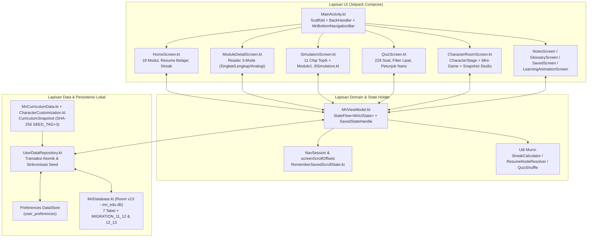
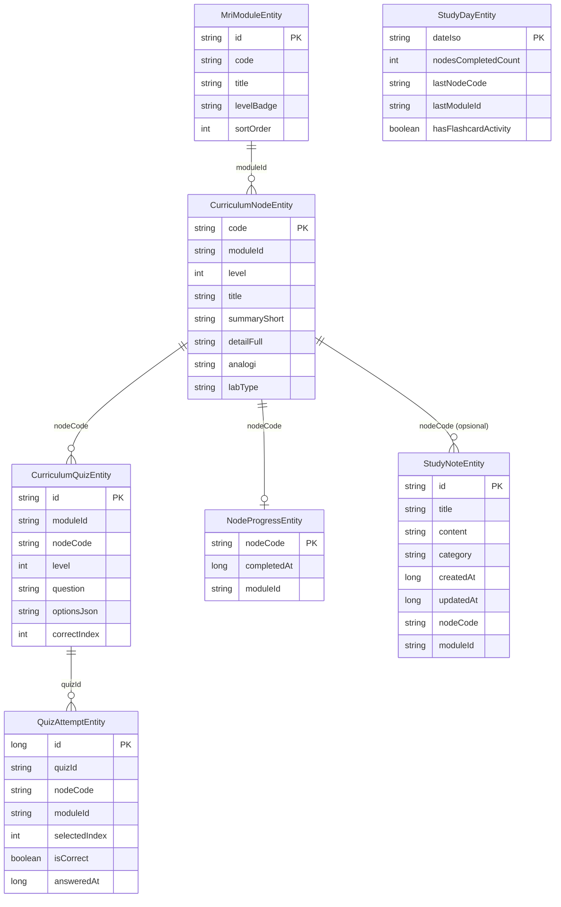
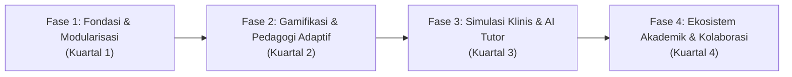

# Peta Desain Arsitektur & Roadmap Pengembangan Besar — Belajar MRI (MRI Learn v3)

Dokumen ini merangkum **analisis mendalam kondisi aktual kode sumber (`MRI-learn-v3`)**, **arsitektur sistem dan basis data**, serta **peta jalan (Grand Roadmap) & saran pengembangan jangka pendek, menengah, dan panjang**.

---

## 1. Profil & Skala Proyek Saat Ini (Berdasarkan Audit Kode Aktual)

| Dimensi | Metrik Terverifikasi | Detail Implementasi |
| :--- | :--- | :--- |
| **Application ID & SDK** | `com.aistudio.mriedu.bjegie` | `minSdk = 24`, `targetSdk = 36`, `compileSdk = 36`, Java 11, Kotlin `2.2.10`, AGP `9.1.1` |
| **Kode Sumber Utama** | **48 file Kotlin (`39.654` baris)** | Arsitektur 100% Jetpack Compose + Material 3 + Coroutines/Flow |
| **Pengujian Otomatis** | **14 file Test (`2.055` baris)** | 12 Unit Test JVM/Robolectric (`1.928` baris) + 2 Android Instrumented Test (`127` baris) |
| **Aset Visual (`res/drawable`)** | **65 file (`6,01 MB`)** | Layer karakter Nano (`1024x1024`), avatar peran (`512x512`), latar panggung (`960x600`), ikon vektor |
| **Kurikulum Terintegrasi** | **18 Modul, 187 Simpul, 229 Kuis** | Tersimpan di [MriCurriculumData.kt](file:///C:/Users/INFINIX/antigravity/MRI-learn-v3/app/src/main/java/com/example/data/MriCurriculumData.kt) (`6.579` baris) & disinkronkan ke Room DB |
| **Referensi Pendukung** | **67 Glosarium & 8 Jaringan** | Kamus istilah radiologi, konstanta relaksasi $T_1/T_2$/PD jaringan, dan dek kartu kilat (`Flashcard`) |
| **Ekosistem Karakter Nano** | **11 Peran & 43 Item Kustomisasi** | `9` Kepala, `9` Seragam, `7` Headset, `8` Alat Klinis, `10` Latar Ruangan + 6 palet aksen di [CharacterCustomization.kt](file:///C:/Users/INFINIX/antigravity/MRI-learn-v3/app/src/main/java/com/example/data/CharacterCustomization.kt) |

---

## 2. Desain Arsitektur Sistem

Aplikasi menerapkan pola **Single-Activity Unidirectional Data Flow (UDF)** berbasis Jetpack Compose. Seluruh state layar, filter, parameter fisika simulator, dan tumpukan sesi navigasi (`NavSession`) dikelola secara reaktif di [MriViewModel.kt](file:///C:/Users/INFINIX/antigravity/MRI-learn-v3/app/src/main/java/com/example/viewmodel/MriViewModel.kt) dan dipersistensikan melalui [UserDataRepository.kt](file:///C:/Users/INFINIX/antigravity/MRI-learn-v3/app/src/main/java/com/example/data/UserDataRepository.kt).

### 2.1 Struktur Navigasi & Pemulihan Sesi (`NavSession`)
- **8 Tab Utama (`MainTab`):**
  - **5 Tab di Bottom Navigation Bar:** `BERANDA`, `SIMULASI`, `CATATAN`, `KUIS`, `KARAKTER` (dengan ikon kustom `NanoHeadNavIcon`).
  - **3 Tab Kontekstual (Diakses dari Beranda/Modul):** `ANIMASI`, `TERSIMPAN`, `GLOSARIUM`.
  - **Layar Detail Modul (`selectedModule != null`):** Menimpa tampilan tab utama dengan tetap menampilkan Bottom Bar.
- **Mesin Back & Scroll Restoration:** Setiap perpindahan tab, pembukaan modul, atau peluncuran lab (`launchM01Lab`..`launchM09Lab`) menyimpan `NavSession` ke dalam `navigationHistory` beserta posisi scroll (`screenScrollOffsets`) melalui [RememberSavedScrollState.kt](file:///C:/Users/INFINIX/antigravity/MRI-learn-v3/app/src/main/java/com/example/ui/components/RememberSavedScrollState.kt).

### 2.2 Desain Skema Basis Data (`MriDatabase` — Room v13)
Database SQLite lokal (`mri_edu.db`) menggabungkan **4 tabel progres pengguna** (pantang dihapus saat migrasi, dijaga oleh [NoDestructiveFallbackTest.kt](file:///C:/Users/INFINIX/antigravity/MRI-learn-v3/app/src/test/java/com/example/NoDestructiveFallbackTest.kt)) dan **3 tabel katalog kurikulum** (di-reseed otomatis bila hash SHA-256 di [CurriculumSnapshot.kt](file:///C:/Users/INFINIX/antigravity/MRI-learn-v3/app/src/main/java/com/example/data/CurriculumSnapshot.kt) berubah):

---

## 3. Peta Kurikulum 18 Modul & Laboratorium Virtual

Seluruh materi disusun berjenjang dalam **4 tingkat kedalaman**: Tingkat `0` (Tujuan Pembelajaran), Tingkat `1` (Dasar/Intuisi), Tingkat `2` (Menengah/Klinis), dan Tingkat `3` (Lanjut/Fisika Matematika), serta disajikan dalam **Reader 3-Mode** (*Singkat*, *Lengkap*, *Analogi*).

| Kode | Judul Modul | Suite Simulator Terkait |
| :--- | :--- | :--- |
| **M01** | Fisika Dasar MRI & Presesi Spin | `Module1LabHub` & `SpinLarmorSimulator` ([Module1Simulators.kt](file:///C:/Users/INFINIX/antigravity/MRI-learn-v3/app/src/main/java/com/example/ui/simulators/Module1Simulators.kt)) |
| **M02** | Relaksasi T1/T2 & Pembobotan Kontras | `Module2LabHub` ([Module2Simulators.kt](file:///C:/Users/INFINIX/antigravity/MRI-learn-v3/app/src/main/java/com/example/ui/simulators/Module2Simulators.kt)) |
| **M03A** | Sekuens Spin Echo, Inversion Recovery & TSE | `Module3SequenceContrastSuite` ([Module3Simulators.kt](file:///C:/Users/INFINIX/antigravity/MRI-learn-v3/app/src/main/java/com/example/ui/simulators/Module3Simulators.kt)) |
| **M03B** | Sekuens Gradient Echo & Keadaan Tunak | `Module3SequenceContrastSuite` ([Module3Simulators.kt](file:///C:/Users/INFINIX/antigravity/MRI-learn-v3/app/src/main/java/com/example/ui/simulators/Module3Simulators.kt)) |
| **M03C** | Mekanisme Kontras Khusus & Agen Kontras | `Module3SequenceContrastSuite` ([Module3Simulators.kt](file:///C:/Users/INFINIX/antigravity/MRI-learn-v3/app/src/main/java/com/example/ui/simulators/Module3Simulators.kt)) |
| **M04A** | Pengodean Spasial: Dari Sinyal Menjadi Gambar | `Module4LabHub` ([Module4Simulators.kt](file:///C:/Users/INFINIX/antigravity/MRI-learn-v3/app/src/main/java/com/example/ui/simulators/Module4Simulators.kt)) |
| **M04B** | Gradien, Ruang-k, dan Fourier | `Module4LabHub` ([Module4Simulators.kt](file:///C:/Users/INFINIX/antigravity/MRI-learn-v3/app/src/main/java/com/example/ui/simulators/Module4Simulators.kt)) |
| **M04C** | Ruang-k Lanjut & Strategi Akuisisi | `Module4LabHub` ([Module4Simulators.kt](file:///C:/Users/INFINIX/antigravity/MRI-learn-v3/app/src/main/java/com/example/ui/simulators/Module4Simulators.kt)) |
| **M05** | Anatomi Pesawat & Sistem Magnet | `Module5HardwareLabSuite` ([Module5Simulators.kt](file:///C:/Users/INFINIX/antigravity/MRI-learn-v3/app/src/main/java/com/example/ui/simulators/Module5Simulators.kt)) |
| **M06A** | Sistem Gradien & Shimming | `Module6GradientRfLabSuite` ([Module6Simulators.kt](file:///C:/Users/INFINIX/antigravity/MRI-learn-v3/app/src/main/java/com/example/ui/simulators/Module6Simulators.kt)) |
| **M06B** | Sistem RF dan Koil | `Module6GradientRfLabSuite` ([Module6Simulators.kt](file:///C:/Users/INFINIX/antigravity/MRI-learn-v3/app/src/main/java/com/example/ui/simulators/Module6Simulators.kt)) |
| **M07A** | Keselamatan MR: Zona, Skrining & Perangkat | `Module7SafetyLabSuite` ([Module7Simulators.kt](file:///C:/Users/INFINIX/antigravity/MRI-learn-v3/app/src/main/java/com/example/ui/simulators/Module7Simulators.kt)) |
| **M07B** | Keselamatan MR: Medan Statis ($B_0$), Proyektil & Kriogen | `Module7SafetyLabSuite` ([Module7Simulators.kt](file:///C:/Users/INFINIX/antigravity/MRI-learn-v3/app/src/main/java/com/example/ui/simulators/Module7Simulators.kt)) |
| **M07C** | Keselamatan MR: RF (SAR), Gradien & Bising | `Module7SafetyLabSuite` ([Module7Simulators.kt](file:///C:/Users/INFINIX/antigravity/MRI-learn-v3/app/src/main/java/com/example/ui/simulators/Module7Simulators.kt)) |
| **M08A** | Artefak Pengodean & Jaringan | `Module8ArtifactsFlowQaSuite` ([Module8Simulators.kt](file:///C:/Users/INFINIX/antigravity/MRI-learn-v3/app/src/main/java/com/example/ui/simulators/Module8Simulators.kt)) |
| **M08B** | Aliran & Artefak Aliran | `Module8ArtifactsFlowQaSuite` ([Module8Simulators.kt](file:///C:/Users/INFINIX/antigravity/MRI-learn-v3/app/src/main/java/com/example/ui/simulators/Module8Simulators.kt)) |
| **M08C** | Artefak Perangkat Keras, Cross-talk & QA | `Module8ArtifactsFlowQaSuite` ([Module8Simulators.kt](file:///C:/Users/INFINIX/antigravity/MRI-learn-v3/app/src/main/java/com/example/ui/simulators/Module8Simulators.kt)) |
| **M09** | Optimasi Protokol & Membaca Layar Konsol | `Module9LabSuite` ([Module9Simulators.kt](file:///C:/Users/INFINIX/antigravity/MRI-learn-v3/app/src/main/java/com/example/ui/simulators/Module9Simulators.kt)) |

---

## 4. Analisis SWOT Teknis & Fondasi Terpasang ("Dormant Hooks")

### Kekuatan Utama
1. **Ketahanan Data Pengguna Tinggi:** Transaksi penyelesaian simpul (`toggleNodeCompletionTransactional` & `markNodeCompletedIfNotYet`), migrasi kode simpul lama ([LegacyCodeMigrator.kt](file:///C:/Users/INFINIX/antigravity/MRI-learn-v3/app/src/main/java/com/example/data/local/LegacyCodeMigrator.kt)), dan larangan `fallbackToDestructiveMigration` menjaga progres pengguna tetap aman.
2. **Guard Tests Ketat:** [CharacterCatalogGuardTest.kt](file:///C:/Users/INFINIX/antigravity/MRI-learn-v3/app/src/test/java/com/example/CharacterCatalogGuardTest.kt), [CurriculumSeedGuardTest.kt](file:///C:/Users/INFINIX/antigravity/MRI-learn-v3/app/src/test/java/com/example/CurriculumSeedGuardTest.kt), dan [ResourceGuardTest.kt](file:///C:/Users/INFINIX/antigravity/MRI-learn-v3/app/src/test/java/com/example/ResourceGuardTest.kt) memagari konsistensi ID, drawable, dan integritas kurikulum.
3. **Interaktivitas Kanvas Kaya:** Seluruh simulator dan panggung karakter Nano digambar secara prosedural dengan `Canvas` Compose tanpa ketergantungan engine game eksternal yang berat.

### Fondasi yang Sudah Disiapkan di Kode Namun Belum Diaktifkan ("Dormant Hooks")
- **Sistem Buka-Kunci Item Berbasis Progres Kurikulum:** Di [CharacterCustomization.kt](file:///C:/Users/INFINIX/antigravity/MRI-learn-v3/app/src/main/java/com/example/data/CharacterCustomization.kt#L75), konstanta `ENFORCE_CURRICULUM_LOCKS` sudah terhubung ke `UnlockRequirement` pada setiap item, namun saat ini bernilai `false`.
- **Kapabilitas AI & Cloud di Konfigurasi Build:** Di [gradle/libs.versions.toml](file:///C:/Users/INFINIX/antigravity/MRI-learn-v3/gradle/libs.versions.toml) dan [app/build.gradle.kts](file:///C:/Users/INFINIX/antigravity/MRI-learn-v3/app/build.gradle.kts), dependensi `firebase-ai`, `firebase-firestore`, `firebase-auth`, `credentials`, `retrofit`, dan `camera` sudah terdaftar (saat ini dikomentari), serta [metadata.json](file:///C:/Users/INFINIX/antigravity/MRI-learn-v3/metadata.json) mencantumkan `MAJOR_CAPABILITY_SERVER_SIDE_GEMINI_API`.

### Bottleneck & Utang Teknis (Technical Debt) Saat Ini
1. **Monolitik File Data & ViewModel:** [MriCurriculumData.kt](file:///C:/Users/INFINIX/antigravity/MRI-learn-v3/app/src/main/java/com/example/data/MriCurriculumData.kt) (`6.579` baris / `513 KB`) dan [MriViewModel.kt](file:///C:/Users/INFINIX/antigravity/MRI-learn-v3/app/src/main/java/com/example/viewmodel/MriViewModel.kt) (`1.680` baris) memuat terlalu banyak tanggung jawab dalam satu berkas.
2. **Absennya `gradle-wrapper.jar`:** Folder `gradle/wrapper/` hanya memiliki `gradle-wrapper.properties` tanpa `gradle-wrapper.jar`, sehingga eksekusi `./gradlew` di CI/CD atau terminal lokal memerlukan pemulihan wrapper.
3. **Ukuran Aset Raster & R8/ProGuard:** `isMinifyEnabled` dan `isShrinkResources` pada build `release` di [app/build.gradle.kts](file:///C:/Users/INFINIX/antigravity/MRI-learn-v3/app/build.gradle.kts#L44-L51) masih `false`, dan beberapa aset PNG/JPG di `res/drawable/` dapat dikonversi ke WebP lossless/lossy untuk memangkas ukuran APK.

---

## 5. Grand Roadmap Pengembangan Kedepan (4 Fase)

### Fase 1 — Stabilisasi Build, Modularisasi Kode & Optimasi Performa (Jangka Pendek)
1. **Pemulihan Gradle Wrapper & Pipeline CI:**
   - Menambahkan kembali `gradle/wrapper/gradle-wrapper.jar` dan workflow GitHub Actions untuk menjalankan `testDebugUnitTest` (`ResourceGuardTest`, `CharacterCatalogGuardTest`, `CurriculumSeedGuardTest`, `MigrationChainTest`, `RoomDaoTest`) di setiap *pull request*.
2. **Pemecahan File Monolitik (`MriCurriculumData.kt` & `MriViewModel.kt`):**
   - Memecah `MriCurriculumData.kt` menjadi file per kelompok modul (`CurriculumM01_M02.kt`, `CurriculumM03_M04.kt`, `CurriculumM05_M06.kt`, `CurriculumM07_M09.kt`, `CurriculumQuizzes.kt`, `CurriculumGlossary.kt`) tanpa mengubah API publik `MriRepository`.
   - Memisahkan state spesifik simulator dan kuis dari `MriViewModel.kt` ke sub-state delegasi (`QuizSessionStateHolder`, `SimulatorLabStateHolder`, `FlashcardStateHolder`).
3. **Optimasi Ukuran APK & R8 Release:**
   - Mengonversi gambar latar dan hero berukuran besar ke format **WebP** serta mengaktifkan `isMinifyEnabled = true` pada build `release` dengan aturan ProGuard untuk Room dan Compose.

### Fase 2 — Gamifikasi Progresif, Spaced Repetition & Kasus Klinis (Jangka Menengah)
1. **Aktivasi Sistem Progres & Buka-Kunci Item Nano (`ENFORCE_CURRICULUM_LOCKS = true`):**
   - Mengaktifkan pembukaan bertahap 43 item dan 10 latar di Ruang Karakter berdasarkan penyelesaian modul (`M01`–`M09`) serta menambahkan animasi perayaan (*Reward Unlock Toast/Modal*) saat simpul prasyarat tercapai.
2. **Misi Harian Shift Radiografer ("Shift Harian Nano"):**
   - Menambahkan 3 misi mikro harian di Beranda & Ruang Karakter (misal: *"Selesaikan 1 simpul M04"*, *"Capai kombo 5x di Mini-Game Koherensi"*, *"Jawab benar 5 soal Tingkat 2"*) yang terintegrasi dengan tabel `study_days`.
3. **Algoritma Spaced Repetition (SRS / SM-2) pada Flashcard & Kuis:**
   - Menambahkan kolom jadwal ulasan (`nextReviewAt`, `easeFactor`, `intervalDays`) melalui migrasi Room `MIGRATION_13_14` agar kartu kilat dan soal yang pernah salah (`stillWrongAttempts`) muncul kembali secara otomatis di waktu optimal.
4. **Penambahan Simulasi pada 15 Simpul yang Belum Memiliki `labType`:**
   - Menghubungkan 15 simpul Tingkat 1–3 yang saat ini belum memiliki tautan `labType` langsung ke aktivitas spesifik di `Module1..9Simulators.kt`.

### Fase 3 — Simulator Konsol Kasus Klinis (OSCE) & Asisten AI Nano (Jangka Menengah–Panjang)
1. **Mode Ujian Praktik Konsol ("Virtual MRI Console OSCE"):**
   - Menggabungkan kalkulator TA/SNR/SAR ([Module9Simulators.kt](file:///C:/Users/INFINIX/antigravity/MRI-learn-v3/app/src/main/java/com/example/ui/simulators/Module9Simulators.kt)) dengan skenario pasien nyata (misal: *Pasien Stroke Akut Gelisah*, *Pasien Implan Koklea*, *Pasien Gagal Ginjal eGFR < 30*).
   - Pengguna harus menyusun parameter `TR`, `TE`, `Flip Angle`, `Matrix`, `NEX`, `Bandwidth`, dan keputusan skrining Zona IV di bawah batas waktu & batas SAR, lalu dinilai oleh Nano.
2. **Integrasi "Tanya Nano AI" Berbasis Gemini API (Kontekstual Kurikulum):**
   - Mengaktifkan kapabilitas `GEMINI_API_KEY` yang sudah disiapkan di `.env.example` dan `metadata.json` dengan sistem *Retrieval-Augmented Generation (RAG)* lokal dari 187 simpul `MriCurriculumData`.
   - Saat pengguna membaca simpul sulit (misal: *Keadaan Tunak BSSFP M03B* atau *Trajektori Ruang-k M04C*) atau salah menjawab kuis, pengguna dapat bertanya bebas kepada Nano dan mendapat penjelasan yang mengacu langsung pada kode simpul terkait.
3. **Pencitraan DICOM Statis Multi-Kontras Interaktif:**
   - Menambahkan penggeser *Window Width / Window Level (WW/WL)* dan perbandingan irisan anatomi nyata (Otak Aksial/Sagital/Koronal, Lutut, Tulang Belakang) di samping kurva sintetis $T_1/T_2$.

### Fase 4 — Ekosistem Akademik (Dosen–Mahasiswa), Ekspor/Impor & Multi-Platform (Jangka Panjang)
1. **Fitur Ekspor/Impor Cadangan Progres & Catatan Belajar (JSON / PDF):**
   - Memungkinkan pengguna mengekspor seluruh catatan belajar (`study_notes`), riwayat kuis (`quiz_attempts`), dan progres simpul (`node_progress`) ke file JSON/PDF melalui `FileProvider` (memanfaatkan infrastruktur [file_paths.xml](file:///C:/Users/INFINIX/antigravity/MRI-learn-v3/app/src/main/res/xml/file_paths.xml) yang sudah ada) untuk pindah perangkat atau dikumpulkan sebagai tugas kuliah.
2. **Mode Kelas Dosen & Mahasiswa:**
   - Memanfaatkan peran `dosen` dan `mahasiswa` yang baru ditambahkan: Dosen dapat membuat **Kode Paket Kuis / Skenario Kasus** (berupa kode pendek/QR dari subset ID soal `CurriculumQuizEntity`), dan Mahasiswa dapat memasukkan kode tersebut untuk mengerjakan evaluasi terarah lalu membagikan sertifikat/kartu hasil skor lewat Snapshot Studio.
3. **Sinkronisasi Cloud Opsional (Firebase Auth & Firestore):**
   - Mengaktifkan dependensi `firebase-auth`, `credentials`, dan `firebase-firestore` di `app/build.gradle.kts` secara opsional (tetap *offline-first* dengan Room sebagai sumber kebenaran utama) agar progres belajar tidak hilang saat ganti ponsel.

---

## 6. Matriks Prioritas Eksekusi (Impact vs Effort)

| Prioritas | Inisiatif Pengembangan | Dampak Edukasi & UX | Kompleksitas Teknis | Target File Utama |
| :---: | :--- | :---: | :---: | :--- |
| **P0** | Pulihkan `gradle-wrapper.jar` & aktifkan CI Unit Test | Tinggi (Keandalan) | Rendah | `gradle/wrapper/`, `.github/workflows/` |
| **P0** | Aktifkan `ENFORCE_CURRICULUM_LOCKS = true` + UI Progress Unlock | Sangat Tinggi (Retensi) | Rendah | [CharacterCustomization.kt](file:///C:/Users/INFINIX/antigravity/MRI-learn-v3/app/src/main/java/com/example/data/CharacterCustomization.kt), [CharacterItemGrid.kt](file:///C:/Users/INFINIX/antigravity/MRI-learn-v3/app/src/main/java/com/example/ui/character/CharacterItemGrid.kt) |
| **P1** | Ekspor/Impor Backup Progres & Catatan Belajar (JSON/Share) | Tinggi (Keamanan Data) | Sedang | [UserDataRepository.kt](file:///C:/Users/INFINIX/antigravity/MRI-learn-v3/app/src/main/java/com/example/data/UserDataRepository.kt), [NotesScreen.kt](file:///C:/Users/INFINIX/antigravity/MRI-learn-v3/app/src/main/java/com/example/ui/notes/NotesScreen.kt) |
| **P1** | Modularisasi `MriCurriculumData.kt` & `MriViewModel.kt` | Tinggi (Maintainability) | Sedang | `app/src/main/java/com/example/data/`, `viewmodel/` |
| **P1** | Misi Shift Harian Nano & Kuis Paket Kode Dosen | Tinggi (Engagement) | Sedang | [HomeScreen.kt](file:///C:/Users/INFINIX/antigravity/MRI-learn-v3/app/src/main/java/com/example/ui/home/HomeScreen.kt), [QuizScreen.kt](file:///C:/Users/INFINIX/antigravity/MRI-learn-v3/app/src/main/java/com/example/ui/quiz/QuizScreen.kt) |
| **P2** | Spaced Repetition (SRS) untuk Flashcard & Soal Salah | Sangat Tinggi (Pedagogi) | Sedang | [Migrations.kt](file:///C:/Users/INFINIX/antigravity/MRI-learn-v3/app/src/main/java/com/example/data/local/Migrations.kt), [FlashcardDeckSection.kt](file:///C:/Users/INFINIX/antigravity/MRI-learn-v3/app/src/main/java/com/example/ui/components/FlashcardDeckSection.kt) |
| **P2** | Virtual MRI Console OSCE (Simulasi Kasus Pasien Terpadu) | Sangat Tinggi (Klinis) | Tinggi | [Module9Simulators.kt](file:///C:/Users/INFINIX/antigravity/MRI-learn-v3/app/src/main/java/com/example/ui/simulators/Module9Simulators.kt), [SimulatorsScreen.kt](file:///C:/Users/INFINIX/antigravity/MRI-learn-v3/app/src/main/java/com/example/ui/simulators/SimulatorsScreen.kt) |
| **P3** | Integrasi Gemini AI Tutor Kontekstual & Cloud Sync | Tinggi (Diferensiasi) | Tinggi | `app/build.gradle.kts`, `UserDataRepository.kt` |
